# Brownfield Spec-Driven Change Workflow

The read-only discovery, approval gates, Spec Kit artifacts, implementation, validation, review, and local squash-merge flow used for this architecture reduction. No remote push is part of the flow.

## Brownfield Spec-Driven Change Workflow

Start with repository evidence, gate writes on compatibility and approval, then move from spec to plan, tasks, implementation, validation, and a reviewed local merge.

```mermaid
flowchart LR
  accTitle: Brownfield Spec-Driven Change Workflow
  accDescr: A left-to-right workflow begins with a read-only repository baseline and pinned-tool compatibility check. Missing Spec Kit setup is initialized only after conflict inspection. Brownfield scan informs approved project templates and a testable spec. Planning, task generation, and analysis precede incremental implementation. Validation and checks loop back to implementation on failure. A full diff review and latest-main integration gate the local squash merge&#59; remote push is excluded.
  baseline["1. Read-only baseline&#58; status, dirty paths, guidance"]
  pins["2. Check Spec Kit and Brownfield compatibility"]
  pin_stop["Stop and resolve pin or environment mismatch"]
  setup_gate["Spec Kit scaffold already present?"]
  init["Initialize Codex skills only after checking conflicts"]
  scan["3. Brownfield scan&#58; code, contracts, docs, quality gates"]
  bootstrap_gate["Project profile or templates need changes?"]
  approval_wait["Wait for explicit bootstrap approval"]
  bootstrap["4. Tailor constitution and templates from verified facts"]
  spec["5. Specify stories, requirements, exclusions, acceptance"]
  clarify_gate["Material ambiguity remains?"]
  clarify["Resolve scope with the user, then update spec"]
  plan["6. Plan&#58; research, model, contracts, quickstart"]
  tasks["7. Generate ordered implementation tasks"]
  analyze["8. Analyze spec, plan, and tasks for gaps"]
  implement["9. Implement approved scope in small slices"]
  validate["10. Brownfield validate read-only"]
  checks["Run authorized formatting, build, test, link checks"]
  review["11. Review full diff and preserve pre-existing work"]
  sync_main["Integrate latest local main&#59; resolve conflicts"]
  squash["12. Squash merge into local main"]
  no_push["No remote push or publish"]
  baseline --> pins
  pins -->|compatible| setup_gate
  pins -.->|incompatible| pin_stop
  setup_gate -->|missing| init
  setup_gate -->|present| scan
  init --> scan
  scan --> bootstrap_gate
  bootstrap_gate -->|approved| bootstrap
  bootstrap_gate -.->|approval needed| approval_wait
  bootstrap --> spec
  bootstrap_gate -->|no profile edit needed| spec
  spec --> clarify_gate
  clarify_gate -->|yes| clarify
  clarify -.->|update acceptance| spec
  clarify_gate -->|no| plan
  plan --> tasks
  tasks --> analyze
  analyze -->|aligned| implement
  analyze -.->|gaps found| plan
  implement --> validate
  validate -->|no issues| checks
  validate -.->|issues found| implement
  checks -->|pass| review
  checks -.->|failure| implement
  review -->|complete| sync_main
  review -.->|blocker| implement
  sync_main --> squash
  squash --> no_push
%% portable-canonical-v2:eyJhY2Nlc3NpYmlsaXR5IjoiQSBsZWZ0LXRvLXJpZ2h0IHdvcmtmbG93IGJlZ2lucyB3aXRoIGEgcmVhZC1vbmx5IHJlcG9zaXRvcnkgYmFzZWxpbmUgYW5kIHBpbm5lZC10b29sIGNvbXBhdGliaWxpdHkgY2hlY2suIE1pc3NpbmcgU3BlYyBLaXQgc2V0dXAgaXMgaW5pdGlhbGl6ZWQgb25seSBhZnRlciBjb25mbGljdCBpbnNwZWN0aW9uLiBCcm93bmZpZWxkIHNjYW4gaW5mb3JtcyBhcHByb3ZlZCBwcm9qZWN0IHRlbXBsYXRlcyBhbmQgYSB0ZXN0YWJsZSBzcGVjLiBQbGFubmluZywgdGFzayBnZW5lcmF0aW9uLCBhbmQgYW5hbHlzaXMgcHJlY2VkZSBpbmNyZW1lbnRhbCBpbXBsZW1lbnRhdGlvbi4gVmFsaWRhdGlvbiBhbmQgY2hlY2tzIGxvb3AgYmFjayB0byBpbXBsZW1lbnRhdGlvbiBvbiBmYWlsdXJlLiBBIGZ1bGwgZGlmZiByZXZpZXcgYW5kIGxhdGVzdC1tYWluIGludGVncmF0aW9uIGdhdGUgdGhlIGxvY2FsIHNxdWFzaCBtZXJnZTsgcmVtb3RlIHB1c2ggaXMgZXhjbHVkZWQuIiwiZGF0YSI6eyJkaXJlY3Rpb24iOiJMUiIsImVkZ2VzIjpbeyJhcnJvdyI6Ii0tPiIsImZyb20iOiJiYXNlbGluZSIsInRvIjoicGlucyJ9LHsiYXJyb3ciOiItLT4iLCJmcm9tIjoicGlucyIsImxhYmVsIjoiY29tcGF0aWJsZSIsInRvIjoic2V0dXBfZ2F0ZSJ9LHsiYXJyb3ciOiItLi0-IiwiZnJvbSI6InBpbnMiLCJsYWJlbCI6ImluY29tcGF0aWJsZSIsInRvIjoicGluX3N0b3AifSx7ImFycm93IjoiLS0-IiwiZnJvbSI6InNldHVwX2dhdGUiLCJsYWJlbCI6Im1pc3NpbmciLCJ0byI6ImluaXQifSx7ImFycm93IjoiLS0-IiwiZnJvbSI6InNldHVwX2dhdGUiLCJsYWJlbCI6InByZXNlbnQiLCJ0byI6InNjYW4ifSx7ImFycm93IjoiLS0-IiwiZnJvbSI6ImluaXQiLCJ0byI6InNjYW4ifSx7ImFycm93IjoiLS0-IiwiZnJvbSI6InNjYW4iLCJ0byI6ImJvb3RzdHJhcF9nYXRlIn0seyJhcnJvdyI6Ii0tPiIsImZyb20iOiJib290c3RyYXBfZ2F0ZSIsImxhYmVsIjoiYXBwcm92ZWQiLCJ0byI6ImJvb3RzdHJhcCJ9LHsiYXJyb3ciOiItLi0-IiwiZnJvbSI6ImJvb3RzdHJhcF9nYXRlIiwibGFiZWwiOiJhcHByb3ZhbCBuZWVkZWQiLCJ0byI6ImFwcHJvdmFsX3dhaXQifSx7ImFycm93IjoiLS0-IiwiZnJvbSI6ImJvb3RzdHJhcCIsInRvIjoic3BlYyJ9LHsiYXJyb3ciOiItLT4iLCJmcm9tIjoiYm9vdHN0cmFwX2dhdGUiLCJsYWJlbCI6Im5vIHByb2ZpbGUgZWRpdCBuZWVkZWQiLCJ0byI6InNwZWMifSx7ImFycm93IjoiLS0-IiwiZnJvbSI6InNwZWMiLCJ0byI6ImNsYXJpZnlfZ2F0ZSJ9LHsiYXJyb3ciOiItLT4iLCJmcm9tIjoiY2xhcmlmeV9nYXRlIiwibGFiZWwiOiJ5ZXMiLCJ0byI6ImNsYXJpZnkifSx7ImFycm93IjoiLS4tPiIsImZyb20iOiJjbGFyaWZ5IiwibGFiZWwiOiJ1cGRhdGUgYWNjZXB0YW5jZSIsInRvIjoic3BlYyJ9LHsiYXJyb3ciOiItLT4iLCJmcm9tIjoiY2xhcmlmeV9nYXRlIiwibGFiZWwiOiJubyIsInRvIjoicGxhbiJ9LHsiYXJyb3ciOiItLT4iLCJmcm9tIjoicGxhbiIsInRvIjoidGFza3MifSx7ImFycm93IjoiLS0-IiwiZnJvbSI6InRhc2tzIiwidG8iOiJhbmFseXplIn0seyJhcnJvdyI6Ii0tPiIsImZyb20iOiJhbmFseXplIiwibGFiZWwiOiJhbGlnbmVkIiwidG8iOiJpbXBsZW1lbnQifSx7ImFycm93IjoiLS4tPiIsImZyb20iOiJhbmFseXplIiwibGFiZWwiOiJnYXBzIGZvdW5kIiwidG8iOiJwbGFuIn0seyJhcnJvdyI6Ii0tPiIsImZyb20iOiJpbXBsZW1lbnQiLCJ0byI6InZhbGlkYXRlIn0seyJhcnJvdyI6Ii0tPiIsImZyb20iOiJ2YWxpZGF0ZSIsImxhYmVsIjoibm8gaXNzdWVzIiwidG8iOiJjaGVja3MifSx7ImFycm93IjoiLS4tPiIsImZyb20iOiJ2YWxpZGF0ZSIsImxhYmVsIjoiaXNzdWVzIGZvdW5kIiwidG8iOiJpbXBsZW1lbnQifSx7ImFycm93IjoiLS0-IiwiZnJvbSI6ImNoZWNrcyIsImxhYmVsIjoicGFzcyIsInRvIjoicmV2aWV3In0seyJhcnJvdyI6Ii0uLT4iLCJmcm9tIjoiY2hlY2tzIiwibGFiZWwiOiJmYWlsdXJlIiwidG8iOiJpbXBsZW1lbnQifSx7ImFycm93IjoiLS0-IiwiZnJvbSI6InJldmlldyIsImxhYmVsIjoiY29tcGxldGUiLCJ0byI6InN5bmNfbWFpbiJ9LHsiYXJyb3ciOiItLi0-IiwiZnJvbSI6InJldmlldyIsImxhYmVsIjoiYmxvY2tlciIsInRvIjoiaW1wbGVtZW50In0seyJhcnJvdyI6Ii0tPiIsImZyb20iOiJzeW5jX21haW4iLCJ0byI6InNxdWFzaCJ9LHsiYXJyb3ciOiItLT4iLCJmcm9tIjoic3F1YXNoIiwidG8iOiJub19wdXNoIn1dLCJub2RlcyI6W3siaWQiOiJiYXNlbGluZSIsImxhYmVsIjoiMS4gUmVhZC1vbmx5IGJhc2VsaW5lOiBzdGF0dXMsIGRpcnR5IHBhdGhzLCBndWlkYW5jZSJ9LHsiaWQiOiJwaW5zIiwibGFiZWwiOiIyLiBDaGVjayBTcGVjIEtpdCBhbmQgQnJvd25maWVsZCBjb21wYXRpYmlsaXR5In0seyJpZCI6InBpbl9zdG9wIiwibGFiZWwiOiJTdG9wIGFuZCByZXNvbHZlIHBpbiBvciBlbnZpcm9ubWVudCBtaXNtYXRjaCJ9LHsiaWQiOiJzZXR1cF9nYXRlIiwibGFiZWwiOiJTcGVjIEtpdCBzY2FmZm9sZCBhbHJlYWR5IHByZXNlbnQ_In0seyJpZCI6ImluaXQiLCJsYWJlbCI6IkluaXRpYWxpemUgQ29kZXggc2tpbGxzIG9ubHkgYWZ0ZXIgY2hlY2tpbmcgY29uZmxpY3RzIn0seyJpZCI6InNjYW4iLCJsYWJlbCI6IjMuIEJyb3duZmllbGQgc2NhbjogY29kZSwgY29udHJhY3RzLCBkb2NzLCBxdWFsaXR5IGdhdGVzIn0seyJpZCI6ImJvb3RzdHJhcF9nYXRlIiwibGFiZWwiOiJQcm9qZWN0IHByb2ZpbGUgb3IgdGVtcGxhdGVzIG5lZWQgY2hhbmdlcz8ifSx7ImlkIjoiYXBwcm92YWxfd2FpdCIsImxhYmVsIjoiV2FpdCBmb3IgZXhwbGljaXQgYm9vdHN0cmFwIGFwcHJvdmFsIn0seyJpZCI6ImJvb3RzdHJhcCIsImxhYmVsIjoiNC4gVGFpbG9yIGNvbnN0aXR1dGlvbiBhbmQgdGVtcGxhdGVzIGZyb20gdmVyaWZpZWQgZmFjdHMifSx7ImlkIjoic3BlYyIsImxhYmVsIjoiNS4gU3BlY2lmeSBzdG9yaWVzLCByZXF1aXJlbWVudHMsIGV4Y2x1c2lvbnMsIGFjY2VwdGFuY2UifSx7ImlkIjoiY2xhcmlmeV9nYXRlIiwibGFiZWwiOiJNYXRlcmlhbCBhbWJpZ3VpdHkgcmVtYWlucz8ifSx7ImlkIjoiY2xhcmlmeSIsImxhYmVsIjoiUmVzb2x2ZSBzY29wZSB3aXRoIHRoZSB1c2VyLCB0aGVuIHVwZGF0ZSBzcGVjIn0seyJpZCI6InBsYW4iLCJsYWJlbCI6IjYuIFBsYW46IHJlc2VhcmNoLCBtb2RlbCwgY29udHJhY3RzLCBxdWlja3N0YXJ0In0seyJpZCI6InRhc2tzIiwibGFiZWwiOiI3LiBHZW5lcmF0ZSBvcmRlcmVkIGltcGxlbWVudGF0aW9uIHRhc2tzIn0seyJpZCI6ImFuYWx5emUiLCJsYWJlbCI6IjguIEFuYWx5emUgc3BlYywgcGxhbiwgYW5kIHRhc2tzIGZvciBnYXBzIn0seyJpZCI6ImltcGxlbWVudCIsImxhYmVsIjoiOS4gSW1wbGVtZW50IGFwcHJvdmVkIHNjb3BlIGluIHNtYWxsIHNsaWNlcyJ9LHsiaWQiOiJ2YWxpZGF0ZSIsImxhYmVsIjoiMTAuIEJyb3duZmllbGQgdmFsaWRhdGUgcmVhZC1vbmx5In0seyJpZCI6ImNoZWNrcyIsImxhYmVsIjoiUnVuIGF1dGhvcml6ZWQgZm9ybWF0dGluZywgYnVpbGQsIHRlc3QsIGxpbmsgY2hlY2tzIn0seyJpZCI6InJldmlldyIsImxhYmVsIjoiMTEuIFJldmlldyBmdWxsIGRpZmYgYW5kIHByZXNlcnZlIHByZS1leGlzdGluZyB3b3JrIn0seyJpZCI6InN5bmNfbWFpbiIsImxhYmVsIjoiSW50ZWdyYXRlIGxhdGVzdCBsb2NhbCBtYWluOyByZXNvbHZlIGNvbmZsaWN0cyJ9LHsiaWQiOiJzcXVhc2giLCJsYWJlbCI6IjEyLiBTcXVhc2ggbWVyZ2UgaW50byBsb2NhbCBtYWluIn0seyJpZCI6Im5vX3B1c2giLCJsYWJlbCI6Ik5vIHJlbW90ZSBwdXNoIG9yIHB1Ymxpc2gifV19LCJkZXNjcmlwdGlvbiI6IlN0YXJ0IHdpdGggcmVwb3NpdG9yeSBldmlkZW5jZSwgZ2F0ZSB3cml0ZXMgb24gY29tcGF0aWJpbGl0eSBhbmQgYXBwcm92YWwsIHRoZW4gbW92ZSBmcm9tIHNwZWMgdG8gcGxhbiwgdGFza3MsIGltcGxlbWVudGF0aW9uLCB2YWxpZGF0aW9uLCBhbmQgYSByZXZpZXdlZCBsb2NhbCBtZXJnZS4iLCJpZCI6ImJyb3duZmllbGRfc3BlY193b3JrZmxvdyIsImtpbmQiOiJmbG93Y2hhcnQiLCJzb3VyY2VTaGEyNTYiOiJiZTJiZDEzZDM2YzBmZTFiODk5OGFjYTY4ZjYwYjIwNDE2ZDgzNGZkYTFiZWVjMGZlNTFjNjk4YTUxZDYzOTM1Iiwic3R5bGVzIjpbXSwidGl0bGUiOiJCcm93bmZpZWxkIFNwZWMtRHJpdmVuIENoYW5nZSBXb3JrZmxvdyIsInZlcnNpb24iOjF9
```

<!-- mermaid:id=brownfield_spec_workflow -->

